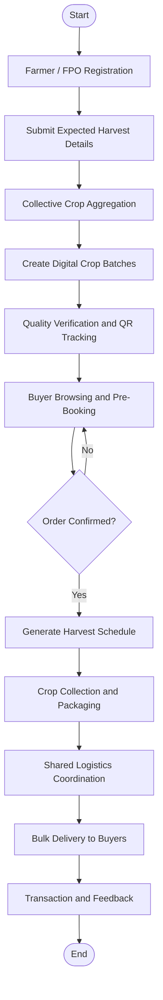

# Smart India Hackathon Workshop

# Date: 25/11/2026

## Reference Number: 26007137

## Name: THARISH K

## Problem Title

SIH 26033: Multiple intermediaries reduce farmers earnings and increase consumer prices.

## Problem Creater's Organization

Ministry of Consumer Affairs, Food & Public Distribution

## Theme

Agriculture, FoodTech & Rural Development

## Problem Description

Expected Solution: Develop **AgriBridge – A Smart Collective Procurement and Harvest Management System** that:

- Enables farmers to combine their agricultural produce into collectively managed batches.
- Allows retailers, wholesalers and bulk buyers to pre-book agricultural produce before harvesting.
- Uses digital quality verification and batch tracking to ensure transparency.
- Implements demand-based harvest planning to reduce overproduction and food wastage.
- Coordinates collective transportation to reduce logistics expenses.

**Benefits:**

- Stronger bargaining power through collective selling.
- Reduced dependency on multiple intermediaries.
- Predictable demand and better harvest planning.
- Reduced post-harvest losses and transportation costs.

## Proposed Solution

### AgriBridge – Smart Collective Procurement & Harvest Management System

**1. Detailed explanation of the proposed solution**

AgriBridge is a digital agricultural coordination platform that brings together small-scale farmers, Farmer Producer Organisations (FPOs), retailers and bulk purchasers.

Instead of selling agricultural produce individually, farmers can register their expected harvest and combine their produce with other farmers to create standardized agricultural batches.

Bulk buyers can browse available batches, compare quality grades and reserve the required quantities before harvesting.

The platform introduces the following features:

- **Collective Crop Aggregation:** Combines produce from multiple farmers into a single bulk-selling batch.
- **Pre-Harvest Booking:** Allows buyers to reserve expected crop quantities before harvesting.
- **Digital Quality Verification:** Maintains quality grades and batch information for transparent purchasing.
- **Smart Harvest Scheduling:** Coordinates harvesting according to confirmed buyer requirements.
- **Batch Traceability:** Provides information about the origin, quantity and movement of agricultural produce.
- **Shared Transportation:** Coordinates transportation for multiple farmers to reduce individual logistics expenses.

**2. How it addresses the problem**

- Reduces the need for multiple intermediaries by enabling collective procurement.
- Improves farmers' bargaining power through bulk selling.
- Reduces uncertainty by connecting farmers with buyers before harvesting.
- Minimizes unnecessary storage and post-harvest wastage.
- Improves transparency through digital quality records and batch tracking.

**3. Innovation and uniqueness of the solution**

The uniqueness of AgriBridge lies in its collective procurement and pre-harvest reservation mechanism.

Unlike conventional agricultural marketplaces that primarily focus on individual product listings, AgriBridge focuses on combining small-scale agricultural supplies into larger, verified batches.

Its demand-based harvesting mechanism helps farmers plan production according to actual buyer requirements rather than relying entirely on uncertain market demand.

## Technical Approach

**1. Technologies to be used**

| Component | Technology |
|---|---|
| Frontend | HTML, CSS, JavaScript / React |
| Backend | Python, Django / FastAPI |
| Database | MySQL |
| Data Analytics | Python, Pandas |
| Quality Management | Digital grading and verification module |
| Batch Tracking | Unique QR Code Generation |
| Maps and Logistics | OpenStreetMap / Routing API |
| Authentication | OTP-based authentication |
| Hosting | Cloud infrastructure |

**2. Methodology and process for implementation**

**Implementation Workflow:**

1. Farmer and FPO registration.
2. Farmers submit expected harvest details, quantity and location.
3. The system groups compatible produce into collective batches.
4. Buyers browse available batches and reserve required quantities.
5. Digital quality verification and batch identification are performed.
6. The system confirms orders and generates harvest schedules.
7. Farmers coordinate harvesting and collection.
8. Shared transportation is arranged for the confirmed batches.
9. Buyers receive produce and confirm delivery.
10. Transaction records and feedback are updated.

**Technical Flowchart:**

## Feasibility and Viability

**1. Analysis of the feasibility of the idea**

- **Technical Feasibility:** The platform can be developed using open-source technologies such as Python, React and MySQL.
- **Economic Feasibility:** Open-source development tools and cloud services can reduce initial implementation expenses.
- **Operational Feasibility:** FPOs and agricultural cooperatives can assist farmers with registration, aggregation and verification.
- **Scalability:** The system can initially be implemented in selected agricultural regions and expanded to different crops and markets.

**2. Potential challenges and risks**

- Difficulty coordinating harvest schedules among multiple farmers.
- Differences in crop quality and grading standards.
- Uncertain harvest quantities due to weather conditions.
- Buyer cancellations after pre-booking.
- Storage and transportation coordination challenges.

**3. Strategies for overcoming these challenges**

- Introduce flexible harvest scheduling and regular crop updates.
- Implement standardized digital quality grading.
- Maintain estimated and verified harvest quantities separately.
- Establish clear booking confirmation and cancellation policies.
- Partner with local FPOs, warehouses and transportation providers.

## Impact and Benefits

**1. Potential impact on the target audience**

- **Farmers:** Improved collective bargaining power, better market access and reduced dependence on intermediaries.
- **FPOs:** Efficient management of aggregated agricultural produce and bulk transactions.
- **Consumers and Retailers:** More predictable supply and improved access to verified agricultural products.
- **Bulk Buyers:** Simplified procurement and better coordination of large-volume orders.

**2. Benefits of the solution**

- **Economic Benefits:** Better selling opportunities through collective procurement and reduced transaction costs.
- **Social Benefits:** Encourages farmer cooperation and strengthens rural agricultural communities.
- **Environmental Benefits:** Reduces avoidable post-harvest wastage and unnecessary transportation.
- **Technological Benefits:** Introduces digital batch tracking, quality verification and demand-based harvest planning.
- **Supply Chain Benefits:** Creates a more organized, transparent and coordinated agricultural procurement ecosystem.
## Research and References

The proposed AgriBridge solution is developed with reference to existing agricultural marketing systems, farmer organizations and digital agriculture initiatives.

**Reference Sources:**

1. **e-NAM (National Agriculture Market)** – https://enam.gov.in/
   - Reference for digital agricultural trading and transparent market access.

2. **SFAC (Small Farmers' Agribusiness Consortium)** – https://sfacindia.com/
   - Reference for Farmer Producer Organisations (FPOs) and collective agricultural marketing.

3. **Ministry of Agriculture & Farmers Welfare** – https://agriwelfare.gov.in/
   - Reference for agricultural development initiatives and farmer welfare.

4. **ICAR (Indian Council of Agricultural Research)** – https://icar.org.in/
   - Reference for agricultural research, crop management and post-harvest practices.

5. **Digital India** – https://www.digitalindia.gov.in/
   - Reference for digital infrastructure and technology-enabled services.

**Research Areas:**
- Collective agricultural marketing.
- Farmer Producer Organisations (FPOs).
- Pre-harvest procurement and demand planning.
- Digital crop quality verification.
- QR-based agricultural batch traceability.
- Shared logistics and supply-chain optimization.

**Note:** AgriBridge is an independently proposed concept. These sources provide background research and inspiration, not evidence of an existing AgriBridge implementation.
